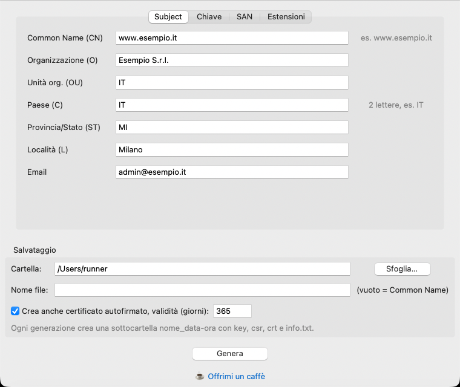
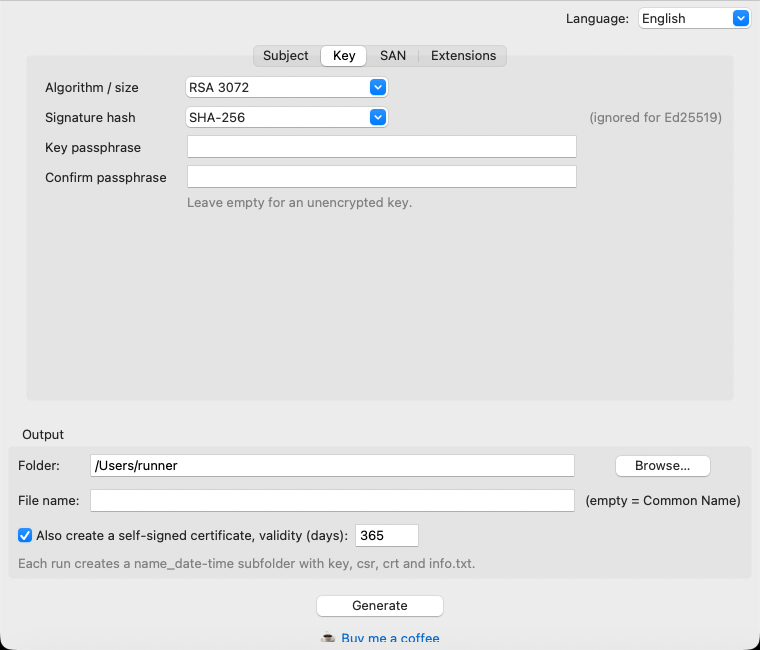
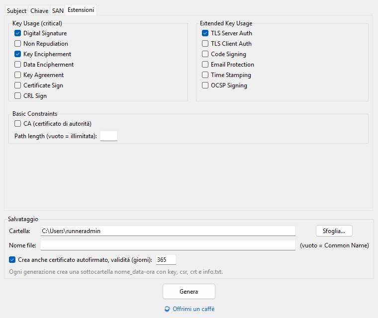

# Wiz CSR

[](https://github.com/renero82/wiz-csr/actions/workflows/build.yml)
[](https://github.com/renero82/wiz-csr/releases/latest)
[](LICENSE)
[](https://buymeacoffee.com/renero82)

**A small portable app to generate private keys, CSRs and self-signed certificates with a point-and-click UI.**
No OpenSSL command line, no config files, no install: download, run, fill in the form.



## Why

Writing an `openssl req` command with the right `-subj`, SAN list and extensions is easy to get wrong,
and a CSR with the wrong SAN costs you a round trip with the CA. Wiz CSR gives you every field in a form
and saves everything in a tidy folder.

## Download

Grab the latest build from the **[Releases page](https://github.com/renero82/wiz-csr/releases/latest)**:

| System  | File                 | Notes                                                              |
|---------|----------------------|--------------------------------------------------------------------|
| Windows | `WizCSR-Windows.exe` | Single portable file. SmartScreen may warn, the app is not signed. |
| macOS   | `WizCSR-macOS.zip`   | Apple Silicon. Unsigned: first launch with right-click > Open.     |

> The interface is available in **English and Italian**: it follows your system language and you can switch it from the top-right corner.

## Features

- **Subject**: CN, O, OU, C, ST, L, email
- **Keys**: RSA 2048 / 3072 / 4096, EC P-256 / P-384 / P-521, Ed25519, with optional passphrase (encrypted PKCS#8)
- **Signature hash**: SHA-256 / 384 / 512
- **SAN**: DNS names, IP addresses, emails, URIs
- **Extensions**: Key Usage, Extended Key Usage, Basic Constraints (CA, path length)
- **Self-signed certificate** (optional): same fields and extensions, validity in days
- **Tidy storage**: you pick the folder; every run creates `name_YYYYMMDD-HHMMSS/` with
  `name.key` (permissions `0600`), `name.csr`, `name.crt` and an `info.txt` summary. Nothing is ever overwritten.
- **English / Italian** interface, switchable on the fly
- Everything runs locally: keys never leave your machine.

| Key and hash | Extensions (Windows) |
|---|---|
|  |  |

## Run from source

```bash
pip install cryptography
python app.py
```

Needs Python 3.10+ with Tkinter (included in the python.org installers).

## Build it yourself

```bash
pip install -r requirements.txt
pyinstaller --noconsole --windowed --onefile --name WizCSR app.py   # Windows
pyinstaller --noconsole --windowed --name WizCSR app.py             # macOS (.app)
```

Or let GitHub do it: the [workflow](.github/workflows/build.yml) builds Windows and macOS,
runs a self-test on the built binaries and publishes a release when you push a `v*` tag.

## Code signing

Free code signing for the Windows builds is planned through the [SignPath Foundation](https://signpath.org).
It is not active yet: current releases are unsigned. See the [code signing policy](CODE_SIGNING.md)
for status, roles and privacy policy.

## Support

If it saved you some time, you can [buy me a coffee](https://buymeacoffee.com/renero82) ☕ and a ⭐ on the repo is always appreciated.

## License

MIT, see [LICENSE](LICENSE).
